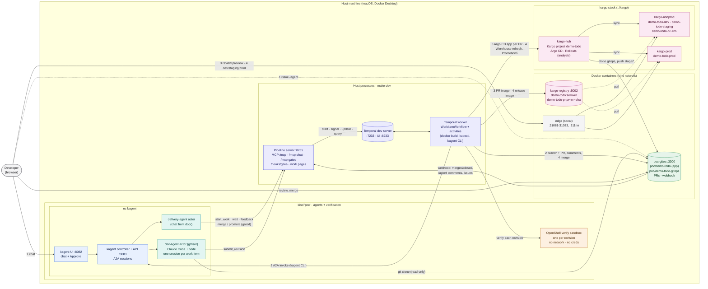
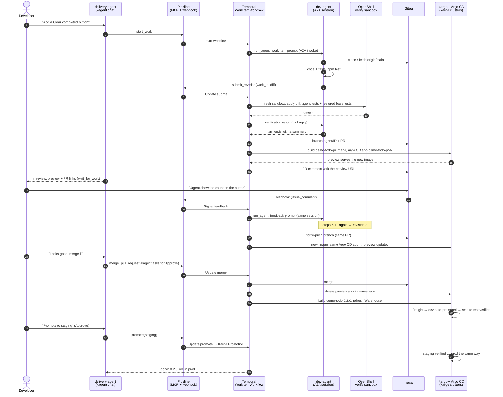
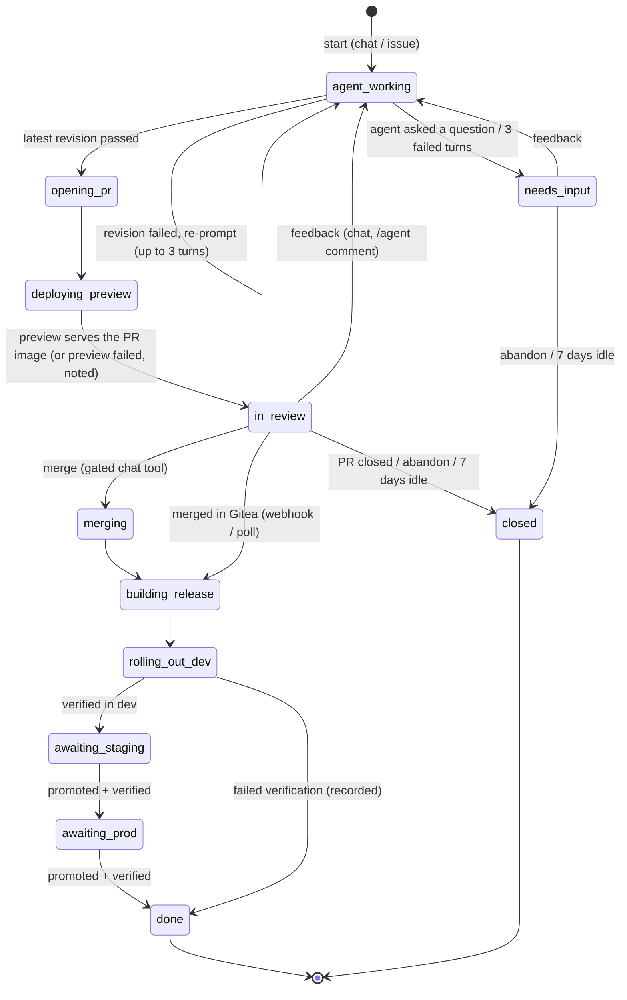

# Architecture

How a request becomes code running in prod. One Temporal workflow per request runs the whole thing:
intake, the coding agent's turns, verification, the PR and its preview environment, review, merge,
release build, and the Kargo rollout through dev → staging → prod. The reasoning behind each choice
is in [adr/](adr/README.md) (start with [0016](adr/0016-temporal-owns-the-work-item.md) and
[0017](adr/0017-kargo-delivery-and-pr-environments.md)). This page is the map.

## The flow in four steps

| # | Step | Who acts | What Temporal does |
|---|---|---|---|
| 1 | **Input**: chat with delivery-agent, or a Gitea issue with `/agent` (Jira later) | a person | starts a `WorkItemWorkflow` |
| 2 | **Agent works**: code + tests, verified in a fresh sandbox, PR published | dev-agent (Claude Code on Substrate) | invokes the agent over A2A, verifies each revision, retries and re-prompts, opens the PR |
| 3 | **Review the PR environment** on kargo-nonprod; feedback goes back to the agent | a person (Gitea or chat) | builds the PR image, deploys the preview via Argo CD, relays feedback, updates the preview |
| 4 | **Merge → build → GitOps rollout**: dev automatically, then staging and prod | a person merges and promotes; Kargo + Argo CD deploy | merges (or sees the webhook), builds the semver release, follows each Kargo stage until it's verified |

## Components and trust boundaries

Colours: blue kagent · teal Substrate actors · orange OpenShell · indigo orchestration (pipeline,
Temporal) · green Gitea · pink kargo stack · grey supporting pieces. Not shown: the model path (actors →
Substrate egress gateway, which injects the key → api.anthropic.com, see [0011](adr/0011-model-credentials.md)).
The rendered SVGs in [img/](img/) predate this flow ([0016](adr/0016-temporal-owns-the-work-item.md)).

What each boundary guarantees:

| Boundary | Holds | Cannot |
|---|---|---|
| **dev-agent actor** (Substrate, gVisor) | Claude Code, the repo checkout, the work item's session | see the model credential, push to Gitea, open/merge a PR, deploy anything, reach anything not in an EgressPolicy |
| **delivery-agent actor** | the chat | write code; merge or promote without a human Approve click |
| **OpenShell verify sandbox** | one revision: base snapshot + diff, test runs | make any outbound connection, read credentials, outlive its verification |
| **Temporal + worker** (host) | work item state, the only path to a PR, a merge, a release, a preview, a promotion | open a PR for an unverified revision, merge with feedback pending, promote out of order (validators) |
| **kagent approval** | the human click on `merge_pull_request` / `promote` | be skipped: those tools sit on a server bound with `requireApproval` |
| **Kargo** | which version is in which stage | promote to staging/prod Freight that wasn't verified upstream |

## A work item, end to end

A merge in the Gitea UI instead of the chat reaches Temporal through the webhook (`pr_event`), with a
5-minute poll as the fallback. A promotion clicked in the Kargo UI is picked up by `wait_for_stage` just
the same.

## Work item lifecycle

Implemented in [worker/work.py](../worker/work.py). Activities are in
[worker/work_activities.py](../worker/work_activities.py) and [worker/delivery.py](../worker/delivery.py).
Verification reuses `start_app_env` / `verify_change` / `stop_app_env` from
[worker/change_activities.py](../worker/change_activities.py).

## Where things live

| Path | What |
|---|---|
| [worker/work.py](../worker/work.py) | `WorkItemWorkflow`: phases, handlers, validators |
| [worker/work_activities.py](../worker/work_activities.py) | activities: `run_agent`, `publish_pr`, `build_image`, `deploy_pr_env`, `release_image`, `wait_for_stage`, … |
| [worker/delivery.py](../worker/delivery.py) | image builds, registry, Argo CD preview apps, edges, Kargo status + promotions, kagent A2A |
| [worker/pipeline_server.py](../worker/pipeline_server.py) | MCP tools for both agents, Gitea webhook, intake, work pages |
| [worker/gitea.py](../worker/gitea.py) | branches, PRs, merges, comments on poc-gitea |
| [worker/apps.py](../worker/apps.py), [change_activities.py](../worker/change_activities.py) | OpenShell / docker verify sandboxes |
| [clusters/poc/kagent/](../clusters/poc/kagent/) | Harness, ModelConfig, EgressPolicy, RemoteMCPServers, dev-agent + delivery-agent and their prompts |
| [clusters/kargo/](../clusters/kargo/) | Kargo project demo-todo (Warehouse, stages, smoke test, promote task), Argo CD ApplicationSet |
| [deploy/gitops/](../deploy/gitops/) | the gitops repo pushed to `poc/demo-todo-gitops`: base, stages, preview overlay |
| [images/demo-todo/Dockerfile](../images/demo-todo/Dockerfile) | release + preview image of the app |
| [clusters/openshell/app-policy.yaml](../clusters/openshell/app-policy.yaml) | verify sandbox policy |
| [scripts/up.sh](../scripts/up.sh), [dev.sh](../scripts/dev.sh), [gitea-up.sh](../scripts/gitea-up.sh), [delivery-up.sh](../scripts/delivery-up.sh) | bring-up |
| [scripts/watch.py](../scripts/watch.py), [mcp_call.py](../scripts/mcp_call.py) | dashboard; call any MCP tool without kagent |
| [demo-app/](../demo-app/) | the target app (seeded into Gitea) |
