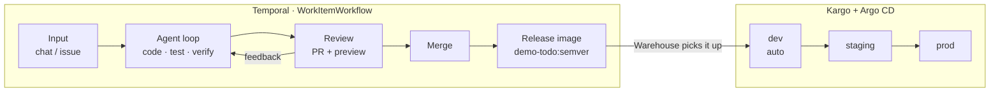
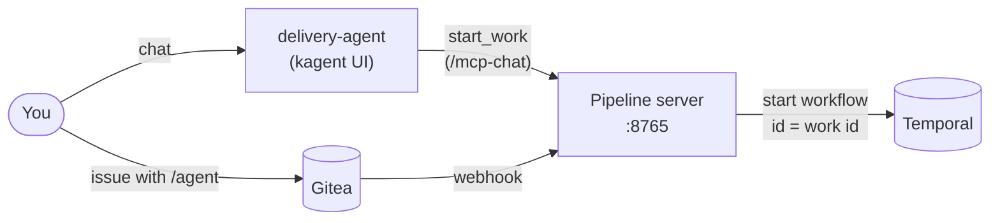
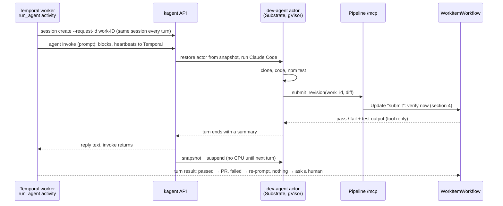
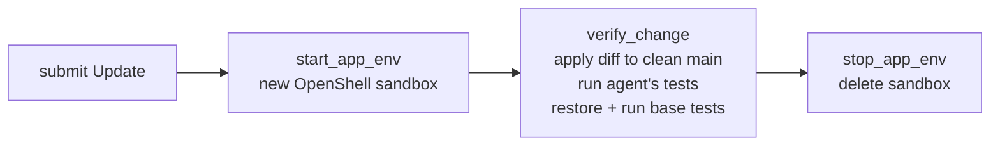
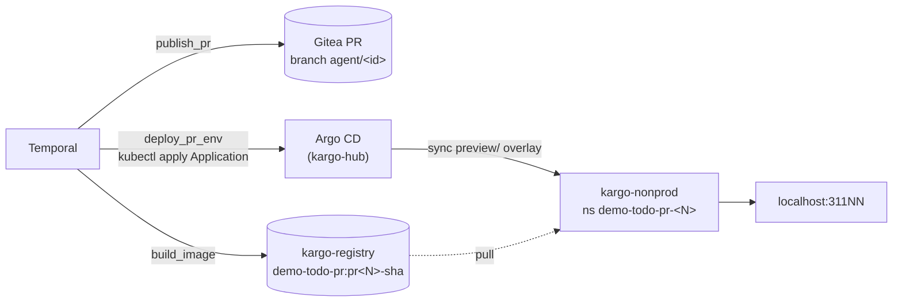
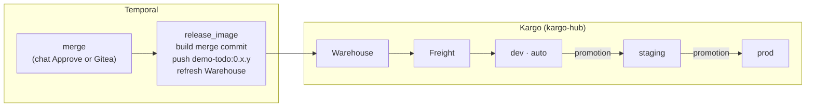
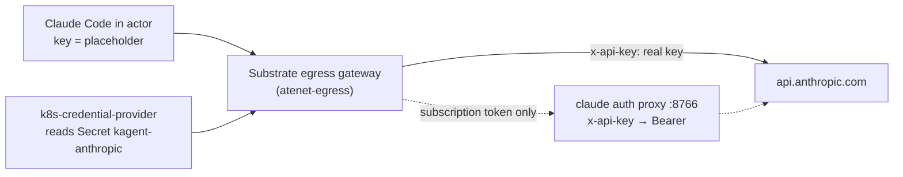
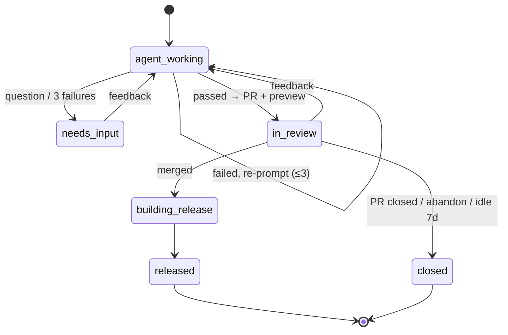

# Architecture

How a request becomes a released image, and how that release reaches prod. The reasoning behind each
choice is in [adr/](adr/README.md), starting with [0016](adr/0016-temporal-owns-the-work-item.md) and
[0017](adr/0017-kargo-delivery-and-pr-environments.md). This page is the map, drawn as several small
diagrams, one per part of the flow.

## 1. The flow, and who owns which part

Temporal runs the part that is non-deterministic or needs stitching across systems: the agent's turns,
retries and re-prompts, verification, the PR and its preview, waiting for review, the merge, and the
release build. **The workflow ends when the release image is pushed.** Rolling it through dev →
staging → prod is Kargo's job. Kargo already records, verifies (smoke test) and gates each promotion,
so Temporal waiting on it would only mirror Kargo's state.

## 2. Intake

Both paths call one function, `start_work_item` in [pipeline_server.py](../worker/pipeline_server.py).
Jira would be one more caller.

## 3. How Temporal drives the kagent agent

Temporal calls the agent; the agent never starts or ends anything itself.

- Turn types: the first prompt, a retry ("revision N failed: …", up to 3 turns), or feedback (from
  chat or a `/agent` PR comment).
- If the worker dies mid-turn, Temporal retries `run_agent`. The prompt says the turn was
  interrupted, and the same session (with its checkout) carries on.
- The `submit` validator refuses revisions unless an agent turn is running.

## 4. Verifying a revision

The sandbox has no network, no credentials, and is used for one revision only
([app-policy.yaml](../clusters/openshell/app-policy.yaml)).

## 5. PR environment (Temporal creates it, Argo CD deploys it)

- Each new revision updates the same Application, so the preview URL stays the same.
- Merge, close or abandon deletes the Application, the namespace and the edge container.
- Kargo is not involved in previews, and preview images never become Kargo Freight.

## 6. Release: where Temporal hands off to Kargo

- Each stage runs an Argo Rollouts canary, then the `smoke-test` analysis.
- Staging only accepts Freight verified in dev, and prod only Freight verified in staging.
- Promote in the Kargo UI, or ask delivery-agent, whose `promote(version, stage)` tool needs an
  Approve click and creates the Kargo Promotion directly.
- `release_status(version)` and the work item page read stage status live from Kargo.

## 7. Model credential path

The ModelConfig ([dev-agent.yaml](../clusters/poc/kagent/dev-agent.yaml)) names the Secret. kagent
gives the actor a placeholder key, and the gateway swaps in the real one on the way out
([0011](adr/0011-model-credentials.md)).

## 8. Where each piece runs

| Where | What |
|---|---|
| Host processes (`make dev`) | Temporal :7233 / UI :8233, worker, pipeline server :8765, claude auth proxy :8766 |
| Docker containers | poc-gitea :3300, kind-registry :5001, edge containers (:31081-3, :311NN) |
| kind `poc` | kagent (UI :8082, API :8083), Substrate actors for both agents, OpenShell verify sandboxes |
| kargo stack (6 kind clusters) | kargo-hub: Kargo, Argo CD, kargo-registry · kargo-nonprod: dev, staging, PR previews · kargo-prod: prod |

What each boundary guarantees:

| Boundary | Holds | Cannot |
|---|---|---|
| **dev-agent actor** (Substrate, gVisor) | Claude Code, the repo checkout, the work item's session | see the model credential, push to Gitea, open/merge a PR, deploy anything, reach anything not in an EgressPolicy |
| **delivery-agent actor** | the chat | write code; merge or promote without a human Approve click |
| **OpenShell verify sandbox** | one revision: base snapshot + diff, test runs | make any outbound connection, read credentials, outlive its verification |
| **Temporal + worker** (host) | work item state, the only path to a PR, a merge, a release, a preview | open a PR for an unverified revision, merge with feedback pending (validators) |
| **kagent approval** | the human click on `merge_pull_request` / `promote` | be skipped: those tools sit on a server bound with `requireApproval` |
| **Kargo** | which version is in which stage | promote to staging/prod Freight that wasn't verified upstream |

## 9. Work item lifecycle

The phases `opening pr`, `deploying preview` and `merging` sit between these states and are shown on
the work item page. Implemented in [worker/work.py](../worker/work.py).

## Where things live

| Path | What |
|---|---|
| [worker/work.py](../worker/work.py) | `WorkItemWorkflow`: phases, handlers, validators |
| [worker/work_activities.py](../worker/work_activities.py) | activities: verify, `run_agent`, `publish_pr`, `build_image`, `deploy_pr_env`, `release_image`, … |
| [worker/delivery.py](../worker/delivery.py) | image builds, registry, Argo CD preview apps, edges, Kargo status + promotions, kagent A2A |
| [worker/pipeline_server.py](../worker/pipeline_server.py) | MCP tools for both agents, Gitea webhook, intake, work item pages |
| [worker/gitea.py](../worker/gitea.py) | branches, PRs, merges, comments on poc-gitea |
| [worker/apps.py](../worker/apps.py), [images/app/supervisor.mjs](../images/app/supervisor.mjs) | OpenShell / docker verify sandboxes and the verifier inside them |
| [clusters/poc/kagent/](../clusters/poc/kagent/) | Harness, ModelConfig, EgressPolicy, RemoteMCPServers, both agents and their prompts |
| [clusters/kargo/](../clusters/kargo/) | Kargo project demo-todo (Warehouse, stages, smoke test, promote task), Argo CD ApplicationSet |
| [deploy/gitops/](../deploy/gitops/) | the gitops repo pushed to `poc/demo-todo-gitops`: base, stages, preview overlay |
| [images/demo-todo/Dockerfile](../images/demo-todo/Dockerfile) | release + preview image of the app |
| [scripts/up.sh](../scripts/up.sh), [dev.sh](../scripts/dev.sh), [gitea-up.sh](../scripts/gitea-up.sh), [delivery-up.sh](../scripts/delivery-up.sh) | bring-up |
| [scripts/watch.py](../scripts/watch.py), [mcp_call.py](../scripts/mcp_call.py) | dashboard; call any MCP tool without kagent |
| [demo-app/](../demo-app/) | the target app (seeded into Gitea) |

Identity (login, agent identities, "on behalf of" attribution) is covered in [identity.md](identity.md).
