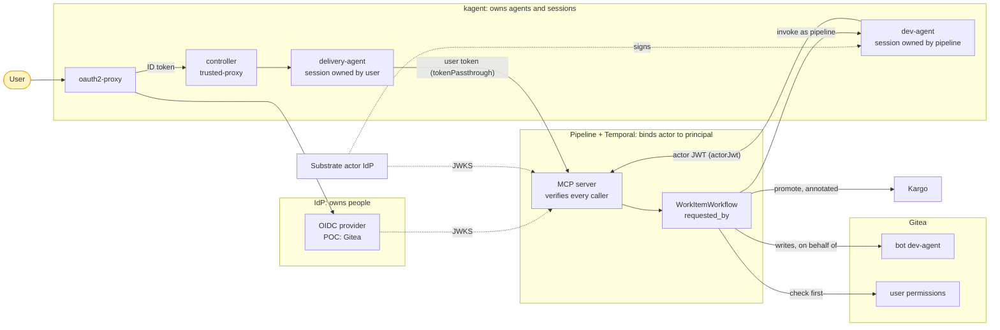
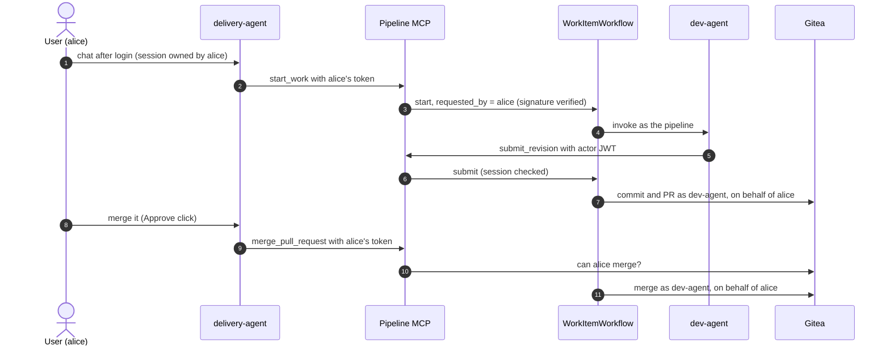

# Identity

Who owns each identity, and how "agent, on behalf of user" is carried from login to PR, merge and
rollout. Decision: [ADR 0018](adr/0018-agent-identity-on-behalf-of-user.md).

> **Status: design, not built.** Today there is no login (kagent `insecure` mode), chat work items
> record `requested_by="chat"`, and every Gitea write uses the `poc` admin account.

## Rules

1. **The IdP owns people.** In the POC that's Gitea's OIDC provider; in production, the corporate
   IdP. kagent, the pipeline, Gitea and Kargo all use that same login.
2. **Agents have their own identity and their own credentials.** They never hold user credentials.
3. **An action records an actor, plus a principal when a human caused it:** `dev-agent (on behalf of
   @alice)`.
4. **On-behalf-of is the intersection of permissions.** The pipeline acts for a user only if that
   user could do the same thing themselves.
5. **Temporal pins the principal.** The pipeline verifies it once, at intake, and stores it as
   `requested_by` on the work item. Later steps read it from there, never from an agent or from text.
6. **Sandboxes hold no forge, Kargo or user credentials.** Only the pipeline writes.

## Who owns what

| Identity | Owned by | Proven by | Verified by |
|---|---|---|---|
| User | IdP | OIDC ID token from oauth2-proxy | oauth2-proxy (signature); kagent `trusted-proxy` reads `preferred_username` |
| User, at the pipeline | IdP | the same token, forwarded by `tokenPassthrough` on `delivery` / `delivery-release` | **the pipeline**, against the IdP's JWKS. kagent does not check signatures |
| dev-agent, at the pipeline | Substrate actor IdP | actor JWT (`actorJwt` on `pipeline`) | the pipeline, which also checks that the token's session is the work item's session |
| dev-agent, in Gitea | Gitea | bot account `dev-agent`; only the pipeline holds its token | Gitea |
| Pipeline | the deployment (ServiceAccount) | SA token (TokenReview) to kagent; its own Gitea and Kargo credentials | kagent, Gitea, Kubernetes RBAC |
| Model key | `kagent-anthropic` Secret | injected by the egress gateway ([0011](adr/0011-model-credentials.md)) | Anthropic. It is not a user identity |

kagent allows only one of `actorJwt` and `tokenPassthrough` per MCP server. That fits this split:
the agent's server carries the agent identity, and the chat servers carry the user's. Servers that
require a caller token need controller tool discovery turned off (`kagent.dev/discovery` label).

## What readers see

| Where | Shown as |
|---|---|
| Commit | author `dev-agent`; trailers `On-behalf-of: alice <email>` and `Work-Item: <id>` |
| PR | opened by `dev-agent`; body starts "Requested by @alice (chat)" or "(issue #12)"; alice is the reviewer |
| Agent comment | `dev-agent`, plus "on behalf of @alice" if a human action caused it |
| Human `/agent` comment, or a merge in the Gitea UI | the human. The webhook `sender` is recorded as `by` |
| Merge from chat | `dev-agent`, message "on behalf of @alice (approved in kagent)" |
| Kargo Promotion | annotations `poc.local/requested-by` and `poc.local/work-item` |
| Temporal | search attribute `RequestedBy`; `by` on every feedback, merge, promote and abandon |

The agent, not the user, is the author because the agent wrote the code. That keeps `git blame` and
review honest, and the trailer keeps the user accountable for the request.

## Plan

1. **Agent identity in Gitea (no IdP needed):**
   - a `dev-agent` bot user and token, with all pipeline writes switched to it (admin for setup only);
   - the trailers, the PR header and on-behalf-of messages;
   - `by` passed through every handler, plus the `RequestedBy` search attribute.
2. **Login:**
   - a Gitea OAuth2 app, kagent's oauth2-proxy and `trusted-proxy` mode;
   - `tokenPassthrough` on the chat servers, with the pipeline verifying the token;
   - a permission check before merge and promote.
3. **Agent workload identity:** `actorJwt` on `pipeline`, verified and bound to the work item's
   session.
4. **Production:**
   - the corporate IdP, with the forge and Kargo federated to it;
   - the pipeline in-cluster with a ServiceAccount;
   - Temporal client credentials.

## Open questions

- Which actor JWT claim holds the session id, and how a pipeline on the host reaches Substrate's
  JWKS (port-forward?). Confirm in phase 3.
- Whether to add `Co-authored-by: user` so the forge shows both avatars. It also implies the user
  co-wrote the code. Default: no.
- Whether to merge as the user via Gitea `Sudo`. Default: no, because it needs an admin token in the
  pipeline.
